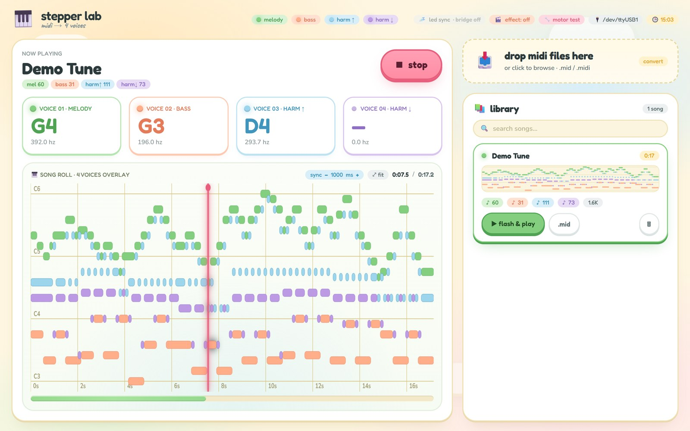

<h1 align="center">Stepper Music</h1>

<p align="center">
  Four NEMA17 stepper motors playing four-part music.<br>
  An Arduino drives the motors, a browser dashboard turns MIDI files into songs for them.
</p>

<p align="center">
   ·
   ·
   ·
   ·
  
</p>

---

<p align="center">
  <a href="https://www.youtube.com/watch?v=OTEYa5xUGrU"></a>
  <a href="https://www.youtube.com/watch?v=Dlnp3UDoSsw"></a>
</p>

<p align="center">
  More recordings on <a href="https://www.youtube.com/@steppersounds/videos">youtube.com/@steppersounds</a>.
</p>

<p align="center">
  
</p>

## What it is

A stepper motor makes a tone when you pulse it at an audible rate: 440 STEP
pulses per second sound like A4. With four motors on their own drivers you get
four independent voices, enough for a melody, a bass line and two harmony
parts.

Each motor has a 3D-printed planetary gearbox on its shaft. It does not change
the pitch, but it makes the motion visible. The gearbox is not my design, it is
[Compact Planetary Gearbox Nema 17](https://makerworld.com/en/models/2770700-compact-planetary-gearbox-nema-17)
by Domino on MakerWorld. Its license does not allow redistributing the files,
so they are not in this repo.

Songs come from MIDI files. The dashboard parses them, squeezes any number of
tracks into four voices and writes a C header that the Arduino sketch compiles
in. One click flashes the UNO and starts playback.

## How it fits together

```
Browser (dashboard, piano roll)
   │  HTTP  /api/*
   ▼
Raspberry Pi: dashboard/server      FastAPI, MIDI library, converter, always on
   │  HTTP  :8766  (flash, go, stop, motor test)
   ▼
PC: bridge/bridge.py                FastAPI + arduino-cli + pyserial
   │  USB, compile + upload, then "GO" over serial
   ▼
Arduino UNO + CNC Shield V3         player.ino, one StepperVoice per axis
   │  STEP/DIR
   ▼
4 × A4988  →  4 × NEMA17 (17HS4401)
```

The Pi keeps the library and the UI online around the clock. The PC with the
Arduino attached is only on when I play something, and the dashboard shows
"bridge unreachable" until it is.

## Parts

| Folder | What it does |
|---|---|
| [`bridge/sketches/player/`](bridge/sketches/player/player.ino) | The player. Non-blocking, one state struct per motor, timing with `micros()`. Notes live in PROGMEM. Waits for `GO` on serial so playback can start in sync with other things (see LED sync below). |
| [`bridge/sketches/`](bridge/sketches) | `silence` (stops playback by flashing over it and disables the drivers), `motor_test` (spins X, Y, Z, A one after another), `a_axis_test` (checks that the A axis is really independent). |
| [`bridge/`](bridge/bridge.py) | Runs on the PC the UNO is plugged into. Finds the CH340 adapter by USB vendor/product ID, writes `song.h`, compiles and uploads with `arduino-cli`, then holds the serial port open for `GO`. |
| [`dashboard/src/`](dashboard/src) | MIDI to four voices: parse with tempo changes, quantize to a grid, arrange, export as a header. |
| [`dashboard/server/`](dashboard/server/server.py) | Runs on the Pi. Library, upload, conversion, proxy to the bridge, and the LED sync engine. |
| [`dashboard/web/`](dashboard/web/index.html) | Single-page UI. Drop MIDI files, see the four voices as a piano roll, flash and play. |

## The fourth axis

A CNC Shield V3 has four driver slots, but the A slot usually only clones X, Y
or Z through jumpers. On this board the A axis can also be driven directly from
D12 (STEP) and D13 (DIR) once the clone jumpers are removed and the D12/D13
selector is set. `a_axis_test` plays 440 Hz on A alone to confirm that before
four-part playback is trusted.

Pin mapping used by all sketches:

| Voice | Axis | STEP | DIR |
|---|---|---|---|
| 1 melody | X | D2 | D5 |
| 2 bass | Y | D3 | D6 |
| 3 upper harmony | Z | D4 | D7 |
| 4 lower harmony | A | D12 | D13 |

`EN` is D8, LOW enables the drivers.

## From MIDI to four voices

MIDI tracks do not map cleanly to four motors. A piano part alone can have ten
notes at once. So the arranger ignores tracks and works on time slices:

1. Parse all note on/off pairs into absolute milliseconds, following every
   tempo change. Drums (channel 10) are dropped.
2. Snap starts and ends to a grid, by default 1/16 notes at the song tempo.
3. For every grid slot, collect the notes that are sounding and assign them:
   highest to voice 1, lowest to voice 2, second highest to voice 3, second
   lowest to voice 4. Taking the outer notes keeps the motors apart in pitch.
   Two steppers a few hertz apart beat against each other and sound bad.
4. Fold notes into MIDI 48 to 96 by octaves, the range where these motors
   sound clean.
5. Merge consecutive slots with the same note and write `{frequency, durationMs}`
   arrays to `song.h`.

The result looks like [`song.h`](bridge/sketches/player/song.h), a short
hand-written chord test. Each event takes 6 bytes of flash. The songs I play
come out at 300 to 3,000 events, so up to about 18 KB, which fits next to the
player in the UNO's 32 KB.

## LED sync

The motors stand in front of my [LED panels](https://github.com/hildlabs/led-panels).
When the LED bridge is reachable, the dashboard can stream light frames in time
with the song: one panel per voice, a pulse on every note, and a light ring
that spins faster for higher notes. To start lights and motors together, the
player waits for `GO` after flashing. Before that, a `TICK` makes all four
motors click once, which gives the audio and the video recording a common
point to line up when editing.

## Setup

Hardware: Arduino UNO (CH340 clone works), CNC Shield V3, four A4988, four
NEMA17 and a supply for the shield. Set the A4988 current limit before running the
motors for longer.

Bridge, on the machine with the UNO (Linux, needs `arduino-cli` with the
`arduino:avr` core, and the user in the group that owns `/dev/ttyUSB*`):

```bash
cd bridge
python -m venv .venv
.venv/bin/pip install -r requirements.txt
.venv/bin/python bridge.py            # listens on :8766
```

Dashboard, on the Pi or the same machine:

```bash
cd dashboard
python -m venv .venv
.venv/bin/pip install -r requirements.txt
STEPPER_BRIDGE_URL=http://<pc>:8766 .venv/bin/python server/server.py   # serves on :8788
```

`LED_BRIDGE_URL` points at the LED panel bridge and is optional. Both folders
have a systemd user unit in `systemd/`.

To test without the dashboard, flash the player with the included `song.h`:

```bash
arduino-cli compile --fqbn arduino:avr:uno bridge/sketches/player
arduino-cli upload -p /dev/ttyUSB0 --fqbn arduino:avr:uno bridge/sketches/player
```

Without a bridge sending `GO`, the player starts on its own after 20 seconds.

## Songs

No MIDI files or generated songs are included, since the ones I play are other
people's music. Drop your own `.mid` files into the dashboard. Melodic,
not-too-dense arrangements work best.

## License

Code under [MIT](LICENSE). The planetary gearbox model belongs to its author
and is only linked.
